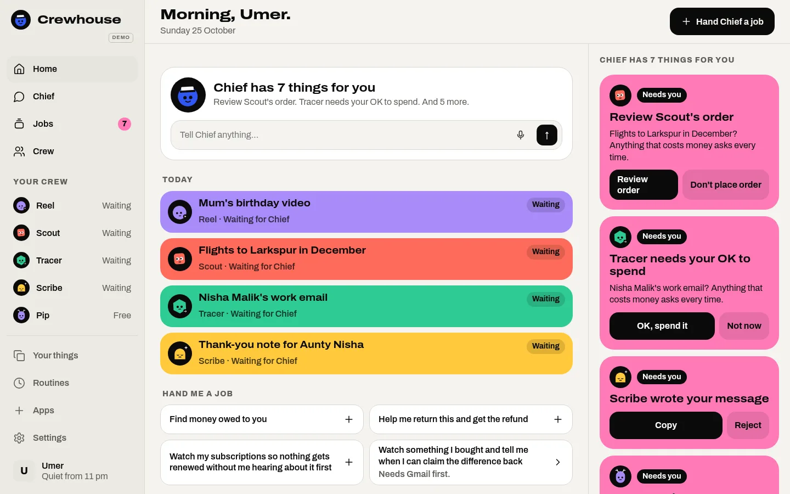
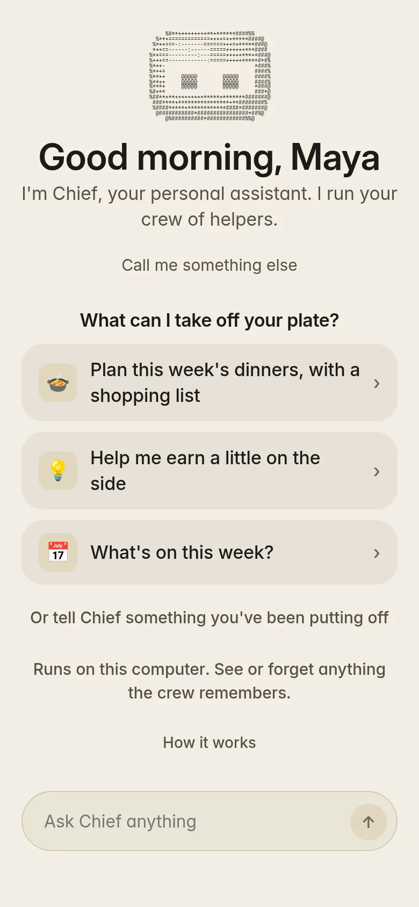
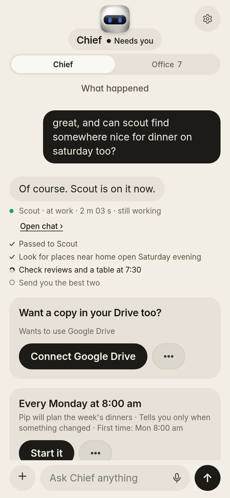
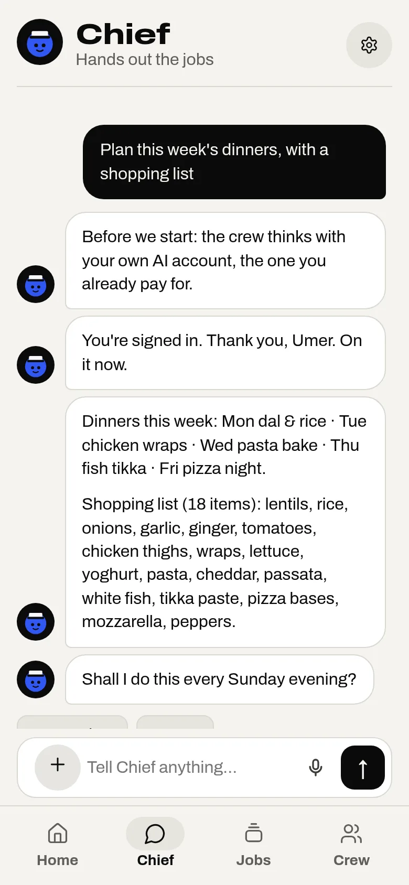
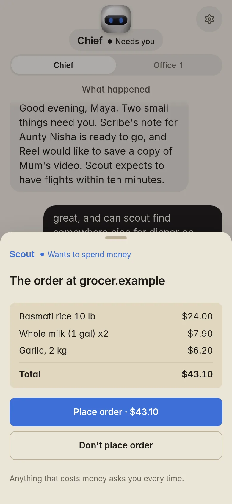
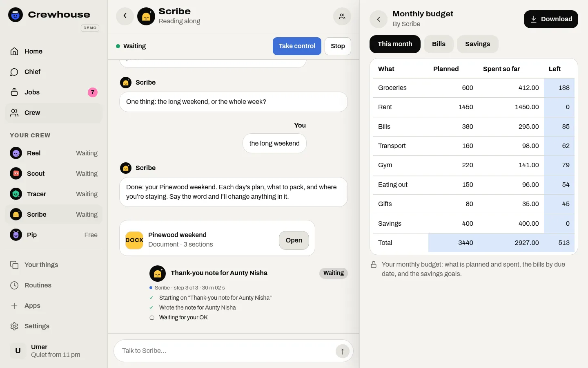

<p align="center">
  
</p>

<h1 align="center">Crewhouse</h1>

<p align="center">
  <strong>Your personal assistant, with a crew of helpers, on your own computer.</strong><br/>
  Ask Chief in plain words. A helper does the job. Anything that sends, spends or deletes asks you first.
</p>

<p align="center">
  <a href="https://github.com/umeranjum17/crewhouse/actions/workflows/ci.yml"></a>
  <a href="LICENSE"></a>
  
  
</p>

<p align="center">
  <a href="https://crewhouse.pages.dev/?demo"><strong>Try the demo</strong></a> ·
  <a href="#quick-start"><strong>Quick start</strong></a> ·
  <a href="TRY-IT.md">30-minute tour</a> ·
  <a href="https://github.com/umeranjum17/crewhouse/releases/download/phone-preview/crewhouse.apk">Android preview</a> ·
  <a href="docs/how-it-works.md">How it works</a>
</p>

<p align="center">
  The demo is the web app on a made-up crew, in your browser: nothing to install, and you can add it to your home screen. Its Pair button connects it to your own computer.
</p>

<p align="center">
  The Android preview link is for 64-bit phones, which is nearly all phones made since 2017. Other phones get their file from the versioned release; see <a href="docs/install.md">docs/install.md</a>.
</p>

<p align="center">
  <picture>
    <source media="(max-width: 600px) and (prefers-color-scheme: dark)" srcset="docs/screenshots/readme/home-phone-night.webp" />
    <source media="(max-width: 600px)" srcset="docs/screenshots/readme/home-phone-day.webp" />
    <source media="(prefers-color-scheme: dark)" srcset="docs/screenshots/readme/home-night.webp" />
    
  </picture>
  <br/>
  <sub>The real app, showing its built-in demo: Umer and his crew. No one's real data.</sub>
</p>

## Why Crewhouse

Your to-do list is full of small jobs that each eat an afternoon: chasing a refund, comparing flights, planning dinners, writing the thank-you note. AI can do them now, but only if it can act, and you don't want it sending or buying on its own.

Crewhouse gives you a crew that does the work and one calm place to say yes. It runs on your computer and thinks with the AI account you already have. There is no Crewhouse server and no telemetry.

## See it work

<table align="center">
  <tr>
    <td align="center" valign="top" width="50%">
      <picture>
        <source media="(prefers-color-scheme: dark)" srcset="docs/screenshots/readme/ask-night.webp" />
        
      </picture>
      <br/><strong>1. Ask Chief</strong><br/><sub>Say it in your own words, or tap an idea.</sub>
    </td>
    <td align="center" valign="top" width="50%">
      <picture>
        <source media="(prefers-color-scheme: dark)" srcset="docs/screenshots/readme/plan-night.webp" />
        
      </picture>
      <br/><strong>2. Watch the plan</strong><br/><sub>Each step ticks off as the helper works.</sub>
    </td>
  </tr>
  <tr>
    <td align="center" valign="top" width="50%">
      <picture>
        <source media="(prefers-color-scheme: dark)" srcset="docs/screenshots/readme/answer-night.webp" />
        
      </picture>
      <br/><strong>3. Get the answer</strong><br/><sub>Plain words, ready to use.</sub>
    </td>
    <td align="center" valign="top" width="50%">
      <picture>
        <source media="(prefers-color-scheme: dark)" srcset="docs/screenshots/readme/spend-night.webp" />
        
      </picture>
      <br/><strong>4. Say yes</strong><br/><sub>Spending asks you every single time.</sub>
    </td>
  </tr>
</table>

<p align="center">
  <picture>
    <source media="(prefers-color-scheme: dark)" srcset="docs/screenshots/readme/files-night.webp" />
    
  </picture>
  <br/><sub>Ask for a spreadsheet or a document and you get a real <code>.xlsx</code> or <code>.docx</code>, open right beside the chat.</sub>
</p>

## Quick start

On **Ubuntu or Debian** (64-bit), with nothing to type:

1. Download **[crewhouse_0.1.1_amd64.deb](https://github.com/umeranjum17/crewhouse/releases/download/linux-v0.1.1/crewhouse_0.1.1_amd64.deb)** (about 200 MB). It carries everything, the AI engine included, so the first start is ready at once. Any other 64-bit Linux: the same release has `crewhouse-0.1.1-linux-x64.tar.gz`; extract it and run `crewhouse/launch.mjs` with its own Node (`crewhouse/node/bin/node crewhouse/launch.mjs`).
2. Open it and press **Install** in your software centre.
3. Open **Crewhouse** from your app menu.

Chief greets you and offers three things to take off your plate. Tap one, then **Sign in with…** under his reply. No terminal logins. You never copy an API key, except where an account is a key: OpenCode Go and MiniMax ask you to paste your key on the card. A helper fetches its own tools, such as its web browser, the first time it needs them.

**From the code** (any Linux, for developers): you need **[Node.js](https://nodejs.org) 24.16 or later on 24, or 26.1 or later**.

```bash
git clone https://github.com/umeranjum17/crewhouse && cd crewhouse
./crewhouse setup     # installs the engine and checks your machine
./crewhouse start     # starts Crewhouse and opens it in your browser
```
A helper fetches its own tools the first time it needs them, so setup installs nothing beyond the engine.

More: [install and run](docs/install.md) (every command, the phone app, the installed web app, where your data lives).

## What you get

- 🧭 **One assistant, many hands.** Chief passes each job to the right helper: Scout looks things up, Scribe writes, Reel makes videos, Tracer finds leads. Want another? Describe it to Chief and approve what he suggests.
- ✋ **Asks before it acts.** Sending, deleting or opening something of yours asks first. Spending asks every time, from the shop's own page.
- ✉️ **Drafts, never sent behind your back.** Anything written in your name arrives as a draft for you to send.
- 📊 **Real files.** Spreadsheets and documents you can open, read and download.
- 🔁 **Routines.** "Every Monday at 8" runs on your computer's own clock, and catches up if it slept.
- 🖥️ **Its own screen.** A helper can get its own browser on its own display. Watch it, or take the wheel.
- 🔌 **Your apps.** Connect Notion, Canva, Google Drive, Calendar or Gmail when a helper needs one.
- 📱 **On your phone.** The Android preview and the installed web app; notifications only ever say "Crewhouse has news".
- 🔒 **Yours.** Runs on your computer with your own AI account. Every note a helper keeps about you can be undone.

## Learn more

- [Vision](VISION.md): who Crewhouse is for, where it is going, and what it is not
- [30-minute tour](TRY-IT.md): a first walk through, step by step
- [How it works](docs/how-it-works.md): each feature in detail, and the pieces underneath
- [Install and run](docs/install.md): commands, updates, the phone app, the installed web app, the desktop bar
- [AI accounts you can use](docs/supported-subscriptions.md) · [Google apps setup](docs/google-setup.md) · [Run your own relay](relay/README.md)
- Not there yet: an iPhone build, a signed Android release, and helpers' screens on macOS and Windows ([details](docs/how-it-works.md#not-yet))

**Contributing:** `npm run check` and `./crewhouse test` (no account, no network). Conventions are in [AGENTS.md](AGENTS.md).

Tests, the stub engine and unmarked lab/proof scripts use a fresh temporary Crewhouse home, an OS-assigned API port and no phone listener. `CREWHOUSE_RUN_MODE=lab` (or `test` / `verify`) forces this mode, including through a product launcher. Explicit `CREWHOUSE_*_DIR` and XDG paths still work, but isolated starts refuse the installed owner's crew, state, tools, engine or Google-client paths, including symlink aliases. Set `TMPDIR` to your lab's scratch folder; its `CREWHOUSE_RUN_HOME` is inherited by children so they share that run's private crew. Product launchers and the installed service keep the normal persistent defaults.

Crewhouse is licensed under the [Apache License 2.0](LICENSE). Third-party notices are in [NOTICE](NOTICE). Your AI account stays subject to its provider's terms.
