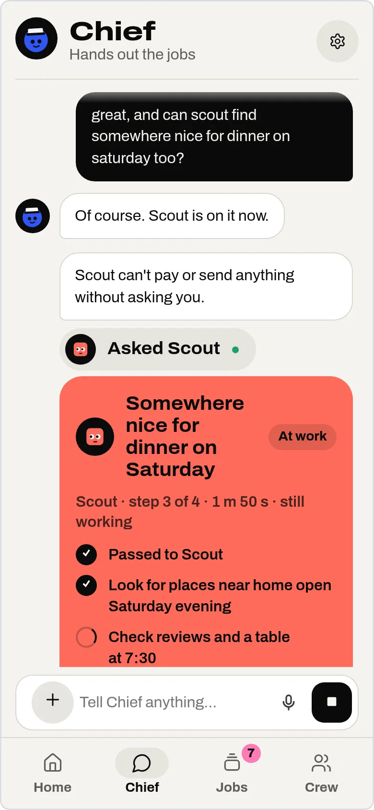
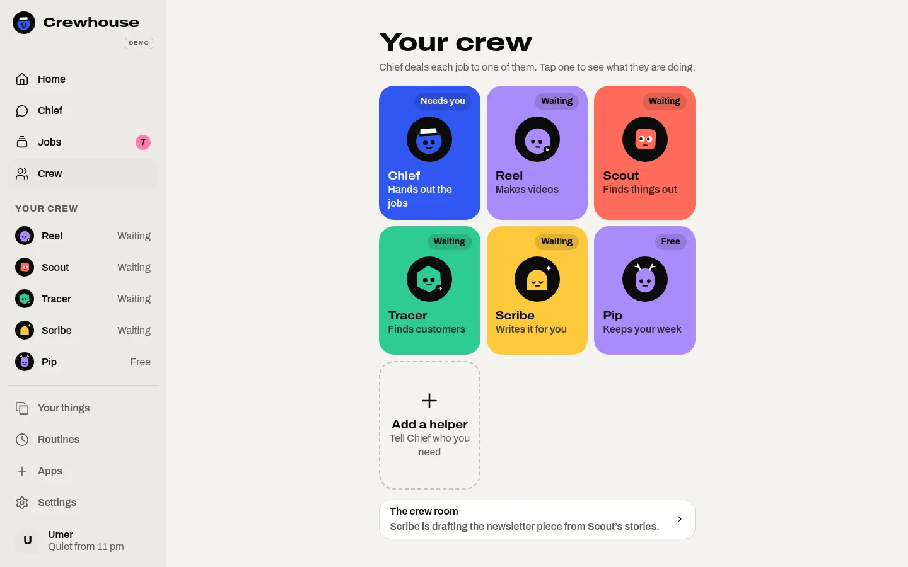

<p align="center">
  
</p>

<h1 align="center">Crewhouse</h1>

<p align="center">
  <strong>A crew of AI helpers that does your errands, and asks before it spends.</strong>
</p>

For anyone drowning in small jobs: it runs on your own Linux computer, thinks with the AI account you already pay for, and anything that sends, spends or deletes waits for your yes.

<p align="center">
  <picture>
    <source media="(max-width: 600px) and (prefers-color-scheme: dark)" srcset="docs/screenshots/readme/home-phone-night.webp" />
    <source media="(max-width: 600px)" srcset="docs/screenshots/readme/home-phone-day.webp" />
    <source media="(prefers-color-scheme: dark)" srcset="docs/screenshots/readme/home-night.webp" />
    
  </picture>
  <br/>
  <sub>The real app on its built-in demo crew. No one's real data.</sub>
</p>

<p align="center">
  <a href="https://crewhouse.pages.dev/?demo"><strong>Try the demo</strong></a> ·
  <a href="#quick-start"><strong>Quick start</strong></a> ·
  <a href="docs/how-it-works.md">How it works</a> ·
  <a href="#the-phone">Phone app</a>
</p>

<p align="center">
  <a href="https://github.com/umeranjum17/crewhouse/actions/workflows/ci.yml"></a>
  <a href="LICENSE"></a>
  
  
</p>

## Quick start

On **Ubuntu or Debian** (64-bit), download `crewhouse_0.1.6_amd64.deb` from the [Linux release](https://github.com/umeranjum17/crewhouse/releases/tag/linux-v0.1.6) into your Downloads folder, then three commands, and Chief asks your name:

```sh
cd ~/Downloads
sudo apt install ./*.deb
crewhouse-app
```

The download is about 180 MB and carries everything, the AI engine included, so the first start is ready at once. Then tap one of the three jobs Chief offers under his first message and press **Sign in with…** under his reply: no terminal logins, and no API key to copy except where the account is a key.

It thinks with the AI plan you already pay for: ChatGPT Plus, Pro or Go, Grok, GitHub Copilot, MiniMax, OpenRouter, OpenCode Go, or the `claude` CLI you already have signed in ([the full list](docs/supported-subscriptions.md)).

Prefer no terminal? Download the same `.deb` and press **Install** in your software centre. Any other 64-bit Linux, the phone app, a cloud host, or a run from the code: [install and run](docs/install.md).

## Why Crewhouse

- **Asking a chat window:** you paste the job, then do the rest yourself — on their servers, on your AI plan.
- **Hiring someone:** a person gives part of their week, and they ask before they spend.
- **Crewhouse:** a helper on your own computer takes one job and reports back, on the AI plan you already pay for — and spending, sending or deleting asks you every single time.

## See it work

<p align="center">
  <picture>
    <source media="(prefers-color-scheme: dark)" srcset="docs/screenshots/readme/loop-night.webp" />
    
  </picture>
  <br/>
  <sub>Three real screens, in order: the ask, the helper at work and the answer — then the order waits for your yes.</sub>
</p>

## What you get

<p align="center">
  <picture>
    <source media="(prefers-color-scheme: dark)" srcset="docs/screenshots/readme/files-night.webp" />
    
  </picture>
  <br/>
  <strong>Real files, not a chat log</strong><br/>
  <sub>Ask for a spreadsheet or a document and you get a real <code>.xlsx</code> or <code>.docx</code>, open beside the chat and yours to download.</sub>
</p>

<p align="center">
  <picture>
    <source media="(prefers-color-scheme: dark)" srcset="docs/screenshots/readme/crew-night.webp" />
    
  </picture>
  <br/>
  <strong>One assistant, many hands</strong><br/>
  <sub>Chief passes each job to the helper whose job it is. Want another? Describe it, and approve who joins.</sub>
</p>

- ✋ **Asks before it acts.** Sending, deleting or opening something of yours asks first. Spending asks every time, from the shop's own page and its own total, never the helper's description of it.
- ✉️ **Drafts, never sent behind your back.** Anything written in your name arrives as a draft for you to send.
- 🔁 **Routines.** "Every Monday at 8" runs on your computer's own clock, and catches up if it slept.
- 🖥️ **Its own screen.** A helper can get its own browser on its own display. Watch it, or take the wheel.
- 🔌 **Your apps.** Connect Notion, Canva, Google Drive, Calendar or Gmail when a helper needs one.
- 🔒 **Yours.** Every note a helper keeps about you can be undone, and the folder it lives in is plain files you can read.

## The phone

The same crew is in your pocket. The Android preview pairs with your computer by QR code or a typed code — over your home Wi-Fi, over Tailscale, or through a relay you run yourself — and its notifications only ever say "Crewhouse has news". An iPhone or iPad can add the web app to its Home Screen and use the same crew. [Install and run](docs/install.md) covers both, and the [releases page](https://github.com/umeranjum17/crewhouse/releases) has the current APK.

## Proof

- **Every picture here is a real capture of this app**, taken by [scripts/capture-readme.mjs](scripts/capture-readme.mjs) on the built-in demo crew, in day and night, on a phone and a computer. Nothing is mocked or redrawn.
- **The demo is the app itself**, on a made-up crew: nothing to install, and its Pair button connects it to your own computer.
- **CI runs the real daemon on every change**: `npm run check`, the suite that boots crewd with a scripted model, and a package job that installs the `.deb` on a clean machine and calls its API ([workflow](.github/workflows/ci.yml)).
- **Honest:** Crewhouse is new, so there are no users to quote yet. If it breaks on your machine, [an issue](https://github.com/umeranjum17/crewhouse/issues) is the most useful thing you can send.

## Known limits

- The computer side is Linux, and built and tested there. On macOS a helper gets no shell and no screen, and autostart is unavailable.
- The Android app is a debug-signed preview; there is no iPhone build and no signed Android release yet.
- Every Linux and phone release is published as a prerelease for now.
- One person per install.

## More

- [30-minute tour](TRY-IT.md): a first walk through, step by step
- [How it works](docs/how-it-works.md): each feature in detail, and the pieces underneath
- [Install and run](docs/install.md): every command, updates, the phone app, the installed web app, a headless cloud host
- [AI accounts you can use](docs/supported-subscriptions.md) · [Google apps setup](docs/google-setup.md) · [Run your own relay](relay/README.md)
- [Vision](VISION.md): who Crewhouse is for, where it is going, and what it is not

## Contributing

`npm run check` and `./crewhouse test` (no account, no network, a fresh temporary Crewhouse home each run). Conventions, the lab rules and the engine seam are in [AGENTS.md](AGENTS.md); the verification runbook is in [docs/verification](docs/verification/README.md).

Crewhouse is licensed under the [Apache License 2.0](LICENSE). Third-party notices are in [NOTICE](NOTICE). Your AI account stays subject to its provider's terms.
